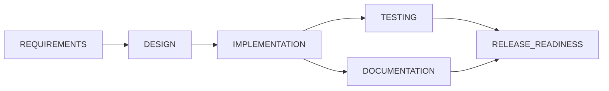
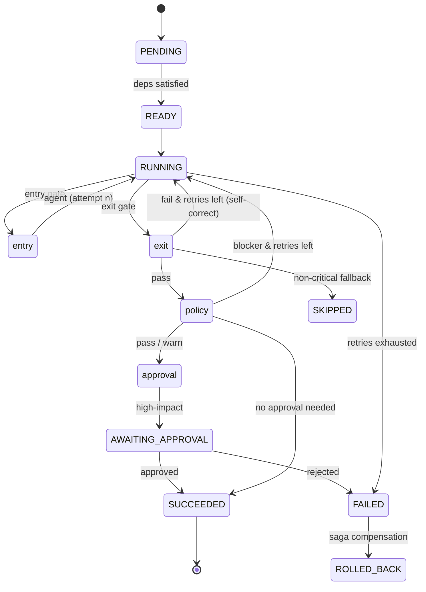

# Architecture Overview

## 1. Two components, one principle

| Component | Role | Framework |
|---|---|---|
| **URL shortener** (`url-shortener/`) | The product being engineered, and the brownfield target codebase | Spring Boot 3 / JPA |
| **Orchestrator** (`orchestrator/`) | The agentic layer that drives the SDLC to produce/enhance the product | Framework-free core + thin Spring REST adapter |

The guiding principle is **controlled autonomy**: agents do stage work and may *propose*, but
every high-impact action passes through a gate the agent cannot bypass, and humans own
approvals and final quality control.

## 2. Why the orchestration core is framework-free

The entire engine — graph, gates, policy, retries, rollback, safe-stop, metrics, audit, and
even the real `AnthropicLlmClient` (built on `java.net.http`) — depends only on the JDK. Spring
appears **only** in `api/` and `config/`. This is deliberate ports-and-adapters design:

- The domain logic is independently testable and runnable (`scripts/run-demo.sh`) with no
  container, no network, and no dependencies.
- The LLM backend, the REST API, and persistence are **adapters** swapped at the edge.
- It keeps the graded centerpiece verifiable in isolation.

## 3. The SDLC execution graph

The orchestrator models the lifecycle as an explicit **dependency DAG**, not a linear chain:



- **Sequential spine:** REQUIREMENTS → DESIGN → IMPLEMENTATION.
- **Parallel fan-out:** TESTING and DOCUMENTATION run concurrently (independent of each other).
- **Synchronization join:** RELEASE_READINESS waits for *both* to finish.

The engine executes in rounds: each round it computes the **ready frontier** (PENDING nodes
whose dependencies are all SUCCEEDED/SKIPPED), runs them in parallel on virtual threads, and
joins before recomputing the frontier. This is what makes execution *non-linear and stateful*
rather than a fixed script.

## 4. Per-stage lifecycle (the governance pipeline)

Every stage runs through the same governed pipeline:



| Control | Where | Behavior |
|---|---|---|
| **Entry gate** | `Gates.entry` | Preconditions: all upstream artifacts present. |
| **Bounded retry** | `OrchestrationEngine` + `RetryPolicy` | Max attempts with exponential backoff; the failure reason is fed back into the next prompt (self-correction). |
| **Exit gate** | `Gates.exit` | Independent, stage-specific validation of output (e.g. `TESTS_PASSED=true`, release `GO=true`) — not "the agent said it's done". |
| **Policy gate** | `PolicyEngine` | Security/compliance/change-control rules; a BLOCKER fails the stage. |
| **Approval checkpoint** | `ApprovalHandler` | High-impact stages (IMPLEMENTATION, RELEASE_READINESS, HIGH risk, or any policy warning) pause for a human decision. |
| **Fallback** | `OrchestrationEngine.fallback` | Non-critical stages (DOCUMENTATION) can be SKIPPED with a placeholder; critical stages fail. |
| **Rollback** | `OrchestrationEngine.rollback` | Saga-style: compensate SUCCEEDED stages in reverse completion order. |
| **Safe-stop** | `SafeStopController` | Operator kill-switch, or auto-trip when the error budget is exceeded. |

## 5. Cross-stage context, decision lineage, and re-planning

- **`RunContext`** is a versioned blackboard. Each stage reads upstream artifacts and writes its
  own; every write bumps a monotonic context version.
- **Decision lineage:** each `Artifact` records the ids of the upstream artifacts it was
  `derivedFrom`, and agents emit `Decision` records with rationale. Together they let you trace
  any output back to the inputs and choices that produced it.
- **Dynamic re-planning:** `engine.replan(run, changedStage)` marks the changed stage's
  transitive dependents STALE→PENDING and invalidates their artifacts, so the next `execute`
  re-derives them against the new context. This models requirements changing mid-flight without
  abandoning governance.

## 6. Observability: audit + metrics

- **`AuditLog`** is append-only with a monotonic sequence and a correlation (run) id. It records
  every transition, gate result, agent call, approval, retry, rollback, policy violation,
  re-plan, and safe-stop — the system of record for "what happened and why".
- **`RunMetrics` / `MetricsRegistry`** track the reliability KPIs the assignment calls out:
  success rate, retry frequency, rollback frequency, MTTR (time from first failure to recovery),
  end-to-end latency, plus LLM call/token counts. Exposed at `/api/v1/runs/{id}/metrics` and
  `/api/v1/metrics`.

## 7. The URL shortener (the product)

```mermaid
graph TD
    C[Client] --> F[RateLimitFilter]
    F --> CT[UrlController]
    CT -->|POST /api/v1/urls| SVC[UrlShortenerService]
    CT -->|GET /{code}| SVC
    SVC --> VAL[UrlValidator]
    SVC --> CACHE[(Caffeine cache)]
    SVC --> REPO[(JPA / H2|Postgres)]
    CT -.async.-> AN[AnalyticsService]
    AN --> REPO
```

Key design points:

- **Collision-free codes:** persist first to get a unique id, then `Base62(id + offset)` — no
  generate-and-check loop. This is a two-phase create (insert → derive code → update) inside one
  transaction, so `short_code` is nullable at the column level (never null by commit). The
  NOT-NULL-preserving alternative is to pre-allocate the id from a DB sequence and insert once;
  the two-phase form was kept for simplicity in the prototype.
- **Dedup:** a wide 64-bit FNV-1a hash of the URL is indexed; an exact string compare confirms.
- **Read-hot path cached:** mappings are effectively immutable, so `resolve()` is cache-aside
  over Caffeine; a cache hit avoids the DB entirely.
- **302 not 301:** so clicks keep hitting the server and analytics stays accurate.
- **Analytics off the hot path:** click recording is `@Async`; losing a metric never breaks a
  redirect.
- **Reliability:** per-client fixed-window rate limiting on writes; optimistic locking
  (`@Version`) on the click counter; global exception handling with typed error bodies.

## 7a. Security (JWT authentication & authorization)

Both APIs are secured with Spring Security 6 as stateless resource servers over self-issued
**HS256 JWTs** (no external IdP required, so the prototype runs offline).

- **Token issuance:** `POST /auth/token` with credentials returns a signed JWT carrying the
  subject and a `roles` claim. `JwtService` signs/verifies with a shared HMAC secret;
  `JwtAuthenticationFilter` turns a `Bearer` token into an authenticated `SecurityContext`.
- **Principals** come from `SecurityProperties` (config-bound, BCrypt-encoded at startup) — a
  stand-in for a real user directory/IdP.
- **Roles:** `ROLE_USER` (read/create), `ROLE_ADMIN` (sensitive ops incl. approvals), and
  `ROLE_AGENT` — the machine/service account with full *operational* access.
- **Governance at the HTTP layer:** the orchestrator restricts
  `POST /api/v1/runs/*/approvals/**` to `ROLE_ADMIN`. Agents can start and drive runs but cannot
  grant approvals — the same "humans own approvals" boundary the engine enforces internally,
  now also enforced at the API edge. The shortener keeps `GET /{code}` (redirect) public.
- **Stateless:** no sessions; CSRF disabled (token-based); a 401 entry point for missing/invalid
  credentials, 403 for authenticated-but-forbidden.

Known limitation: the two modules currently duplicate the ~6 small security classes rather than
sharing a `common-security` module — a deliberate trade-off to keep each app's component scan
simple; extracting a shared module (or a Boot auto-configuration) is the natural next step.

## 8. Key decisions (and the trade-offs)

| Decision | Why | Trade-off |
|---|---|---|
| Framework-free engine core | Testable/runnable in isolation; adapters at the edge | A little more wiring than annotating everything |
| Round-based parallel frontier | Simple, deterministic synchronization join | Coarser than a fully event-driven scheduler |
| Deterministic LLM for tests/demo | Hermetic, fast, reproducible; no cost | Canned outputs are not a substitute for real-model evaluation |
| Hand-rolled JSON in the LLM client | Zero dependencies; whole core runs on bare JDK | Not a general JSON parser; scoped to the Messages API shape |
| In-memory audit/metrics/run stores | Prototype simplicity | Not durable; see limitations |
| 302 redirects | Accurate click analytics | Slightly higher server load than cached 301s |

## 9. Known limitations

- **Persistence of orchestrator state** is in-memory (audit, metrics, runs). Production would
  persist these to a database/event store and make runs resumable across restarts.
- **Rate limiting and caching are per-instance.** A multi-instance deployment needs a shared
  store (e.g. Redis) and a distributed id allocator (ticket server / Snowflake) to replace the
  single DB sequence.
- **Code artifacts are represented, not applied.** The ImplementerAgent produces a described
  change; wiring it to real VCS commits/PRs and running the compiler/test suite as the exit gate
  is the obvious next step (the gate interface is already the seam for it).
- **Sequential Base62 codes are enumerable** (not a security control); encrypting the id is a
  candidate brownfield enhancement.
- **Approval timeout defaults to reject** after the window — safe default, but tune per policy.
